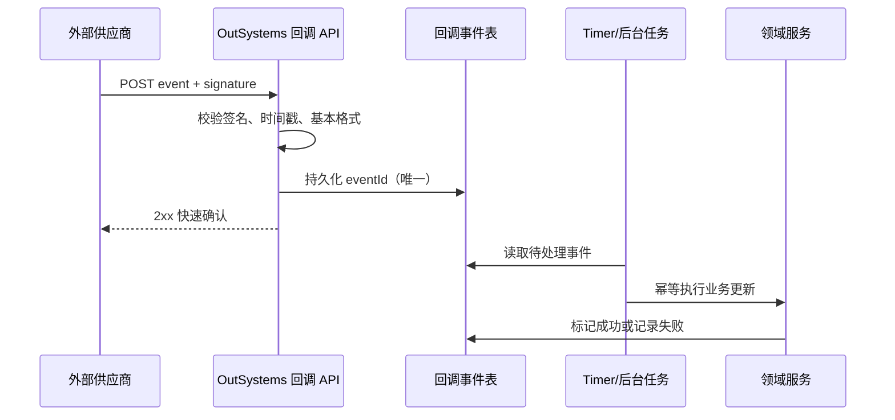

# OutSystems 高频面试题与实战指南：API 与外部服务集成

> **适用范围**：OutSystems 11（Traditional / Reactive Web）为主；其中的 REST、SOAP、数据建模、安全、发布和运维原则同样适用于 ODC。不同平台版本的菜单名称或治理能力可能略有差异，面试时应明确说明自己实际使用的平台与版本。  
> **核心考察点**：面试官通常不只想听到“会 Consume REST API”，而是要确认候选人是否能在生产环境中安全、可观测、可恢复地完成集成，并将外部不稳定性隔离在应用边界之外。

---

## 一、回答集成类问题的通用框架

面对“你做过什么 OutSystems 集成？”这类开放题，可以按以下顺序回答：

1. **业务目标**：集成解决什么问题，例如支付、CRM 同步、订单履约或身份认证。
2. **边界与契约**：调用方向、协议、API 版本、认证方式、数据所有权和 SLA。
3. **实现方式**：使用 Service Studio 消费 REST/SOAP、暴露 REST API，还是通过 Integration Studio / 外部组件扩展。
4. **可靠性**：超时、错误映射、幂等、重试、异步化、降级和补偿。
5. **安全与治理**：凭据保管、权限、输入校验、审计、敏感数据脱敏及环境配置。
6. **交付结果**：性能、错误率、发布方式、测试覆盖率，以及实际带来的业务收益。

下面是一个可复用的简短回答示例：

> “我负责将 Reactive Web 订单模块与第三方支付和 ERP 集成。支付使用同步 REST 调用获取支付会话，最终状态通过回调异步确认；ERP 使用按批次的后台同步。所有调用都封装在 Service Module 中，统一处理 OAuth Token、超时、错误分类和关联 ID。创建支付请求携带幂等键，外部服务不可用时不重复扣款，而是把订单转为待确认并由 Timer 重试。凭据使用环境配置管理，日志不记录授权头和完整卡号。上线后通过 Service Center 的 Integration/Error 日志和应用指标追踪，支付确认失败率下降，人工对账量也明显减少。”  

---

## 二、OutSystems 基础与架构高频题

### 1. OutSystems 的模块类型如何划分？为什么集成逻辑通常放在 Service Module？

**参考答案：**

- **Core Module**：放领域实体、基础规则和被多个模块复用的稳定能力。
- **Service Module**：放服务层编排、外部 API 适配、集成 DTO、共享业务服务；它不需要 UI。
- **Reactive Web / Traditional Web Module**：放页面、客户端交互和与用户体验紧密相关的逻辑。
- **Library / Extension**：Library 用于共享客户端或服务器逻辑；Extension 通常由 Integration Studio 创建，用于封装 .NET/Java 或数据库等平台无法直接完成的能力。

把 API 集成放在 Service Module 的原因是：UI 不应直接依赖供应商的字段、认证细节和失败行为。通过服务层包装后，页面只调用稳定的内部 Action；当供应商更换、接口升级或需要加入缓存、重试、审计时，改动被限制在集成边界内。

**加分点：**说明不要把“供应商响应结构”直接作为整个应用的领域模型。应在适配层将外部 DTO 映射为内部 DTO 或领域实体，避免供应商字段泄漏到 UI 和核心业务逻辑。

---

### 2. 如何设计一个可维护的 OutSystems 应用依赖关系？

**参考答案：**

- 采用由底向上的依赖：基础数据与核心规则在底层，服务编排在中层，UI 在上层。
- 避免循环依赖；若两个模块互相引用，通常说明职责边界不清，应抽出第三个共享模块或通过服务接口解耦。
- 对外系统建立专门的 Adapter/Integration Service，不让多个业务模块分别持有 Token、Endpoint 和响应解析逻辑。
- 尽量暴露最小、稳定的公共 API；不要因为方便就把内部实体和所有 Server Action 都设为 Public。
- 升级公共模块前，在 Service Center / LifeTime 中评估消费者和影响范围，并进行回归测试。

**面试陷阱：**“所有逻辑都放在一个 eSpace，发布最快。”这会在短期内看似高效，但会造成编译影响面大、协作冲突多、复用困难，也无法隔离外部集成变化。

---

### 3. Reactive Web 中哪些逻辑应该放在 Client Action，哪些必须放在 Server Action？

**参考答案：**

- **Client Action**：输入格式检查、页面状态、弹窗、组件交互和无需访问敏感服务器资源的轻量操作。
- **Server Action**：数据库读写、调用外部 API、使用密钥、权限判断、事务性业务规则和敏感数据处理。

外部 API 调用通常应该在 Server Action 中执行，因为认证凭据不能下发到浏览器；服务端还更适合统一记录审计日志、超时、关联 ID 以及处理异常。即便 API 支持浏览器跨域调用，也不应为了绕过服务端而把服务密钥暴露给客户端。

---

### 4. OutSystems 中如何选择 Entity、Static Entity 和 Structure？

| 类型 | 适合场景 | 关键注意点 |
|---|---|---|
| Entity | 需要持久化、查询、关系和事务的数据，如订单、同步任务 | 根据常用查询建立合适索引；控制实体暴露范围 |
| Static Entity | 很少变化的枚举，如订单状态、集成错误分类 | 发布时更新；不要用来存运营人员频繁维护的数据 |
| Structure | 内存中的输入/输出 DTO、API 请求响应或临时聚合数据 | 不持久化；应与外部契约隔离，避免随意复用为领域实体 |

例如，`PaymentStatus` 可以是 Static Entity；`PaymentAttempt` 应为 Entity；第三方支付的 `CreatePaymentResponse` 应先映射到 Structure，再映射到内部的支付记录。

---

## 三、REST API 集成：Hands-on 核心题

### 5. 在 Service Studio 中消费一个 REST API 的标准步骤是什么？

**参考答案：**

1. 在模块的 **Integrations** 中选择 **Consume REST API**，导入 OpenAPI/Swagger 描述或填写 API 地址。
2. 验证每个 Method 的 URL、HTTP Method、Path/Query/Header 参数、请求体与响应体映射。
3. 为请求和响应生成的 Structure 命名，使其符合领域语义，而不是完全沿用供应商的模糊字段名。
4. 在 `OnBeforeRequest` 中设置公共 Header、认证信息、关联 ID、超时或必要的请求转换。
5. 在 `OnAfterResponse` 或调用方中处理状态码和错误响应，映射为应用可理解的错误类型。
6. 用 Server Action 包装生成的 REST Method，执行参数校验、领域映射、日志和异常策略。
7. 在开发、测试、生产环境分别配置 Endpoint 和凭据，不在模块中硬编码。
8. 对成功、认证失败、限流、超时、格式错误和重复请求做测试。

**实践要点：**导入成功只是起点。必须逐一检查生成的请求/响应类型是否符合实际 API 文档，尤其是 nullable 字段、日期格式、分页字段、非 2xx 错误体和数组嵌套结构。

---

### 6. 你如何处理 REST API 的认证？不同认证方式如何选？

**参考答案：**

| 认证方式 | 典型场景 | OutSystems 实现要点 |
|---|---|---|
| API Key | 内部服务或简单 SaaS | 在请求 Header 中设置；密钥放环境配置，不写入 Action 或客户端变量 |
| Basic Auth | 旧系统或受控内部接口 | 使用 TLS；账号密码安全保存；不把 Authorization Header 写到日志 |
| OAuth 2.0 Client Credentials | 服务到服务调用 | 单独封装获取 Token 的服务，缓存直到过期前；Token 获取失败要有明确错误与监控 |
| OAuth 2.0 Authorization Code | 用户授权访问第三方资源 | 处理授权跳转、`state`/PKCE、回调、Token 刷新和用户撤销授权 |
| mTLS / 签名 | 金融、政府或高安全集成 | 证书和私钥由平台安全配置管理；与运维团队明确证书轮换和到期告警 |

**Token 缓存设计：**

- 缓存 Token、到期时间和获取时间，而不是每个业务请求都重新申请。
- 使用“过期前缓冲”，例如还有少量有效期时主动刷新，避免请求刚发出即过期。
- 并发场景避免所有请求同时刷新 Token；可采用受控的单飞刷新或短时间锁。
- 收到 `401/403` 时，先区分 Token 失效、权限不足和接口配置错误。仅在可确认 Token 失效时刷新后**有限次数**重试，防止无限循环。

---

### 7. 如何在 OutSystems 中处理 REST 的错误码和错误响应？

**参考答案：**

不能把所有失败都显示为“调用失败”。应把外部错误转换为内部的、可操作的分类，例如：

| HTTP / 异常 | 内部分类 | 对用户/调用方的行为 | 后续处理 |
|---|---|---|---|
| 400 / 422 | `ValidationError` | 显示可修正的业务提示 | 记录字段级错误，不重试 |
| 401 / 403 | `AuthenticationOrAuthorizationError` | 显示无权限或系统配置问题 | 告警；检查 Token/Scope |
| 404 | `ExternalResourceNotFound` | 依据业务决定提示或创建流程 | 不盲目重试 |
| 409 | `Conflict` | 提示状态已变化或请求重复 | 查询最终状态或走幂等处理 |
| 429 | `RateLimited` | 友好提示或排队 | 按 `Retry-After` 延后执行 |
| 5xx / 网络超时 | `TransientIntegrationError` | 显示稍后重试或进入处理中 | 有条件重试、监控、补偿 |
| 无法解析的响应 | `ContractError` | 不暴露原始细节 | 立即告警；检查接口兼容性 |

**实现方式：**

- 保留 HTTP 状态码、供应商错误码、外部请求 ID 和关联 ID，方便排查。
- 日志记录经脱敏后的请求摘要和响应摘要，绝不记录密钥、Bearer Token、密码或完整身份证/银行卡信息。
- 对 UI 返回统一的业务错误文本；内部诊断信息只写入受保护日志。
- 不使用空结果或默认成功值掩盖异常。调用方必须能区分“没有数据”与“集成失败”。

---

### 8. 一个外部 API 调用超时了。是否应该自动重试？

**参考答案：**

不应无条件重试。超时只说明客户端没有在限定时间内得到响应，并不说明服务端没有执行。对创建订单、扣款、发送短信等有副作用的请求，盲目重试可能产生重复业务。

应根据请求的**幂等性**决定：

- `GET` 等只读请求通常可以进行有限次数重试。
- `PUT`/`DELETE` 是否可重试取决于接口契约是否幂等。
- `POST` 创建类请求只有在供应商支持幂等键，或本方可通过业务唯一键确认结果时，才应自动重试。

推荐策略：

1. 设置合理的连接和响应超时，不让页面无限等待。
2. 只对可恢复、可重试的错误（短暂网络失败、部分 5xx、429）重试。
3. 使用指数退避和抖动（jitter），限制最大次数和最长等待时间。
4. 对不可安全重试的操作，将记录标记为“处理中/待确认”，随后查询状态或由后台任务补偿。
5. 每次重试都记录次数、原因和关联 ID；达到阈值后触发告警或人工队列。

---

### 9. 什么是幂等性？请用支付或订单场景说明如何实现。

**参考答案：**

幂等性指同一个业务请求执行一次或多次后，最终业务结果相同。它是集成可靠性的关键，因为网络超时、用户刷新页面和消息重复投递都会产生重复请求。

以“创建支付”为例：

1. 页面提交前在服务端创建 `PaymentAttempt`，并生成唯一的 `IdempotencyKey`。
2. 调用第三方支付创建接口时，把该键放到供应商规定的 Header 或请求字段。
3. 在本地保存外部支付 ID、请求摘要、状态和该幂等键。
4. 同一个订单再次提交时，先查找未完成或已成功的 `PaymentAttempt`；不重复创建新的扣款。
5. 超时后不要直接再扣款。使用同一幂等键重试，或调用供应商查询接口确认最终结果。
6. 对异步回调也按外部事件 ID 去重，确保重复通知只更新一次业务状态。

**面试加分：**说明“数据库唯一约束 + 本地业务状态 + 供应商幂等键”要一起使用。单靠前端按钮禁用不能防止网络重试和并发请求。

---

### 10. 如何实现分页 API 的同步，并避免遗漏或重复数据？

**参考答案：**

先确认供应商使用的是页码、偏移量还是 Cursor。对于变化频繁的大数据集，Cursor 往往更可靠。

推荐设计：

- 建立 `SyncCheckpoint` 实体，保存上次成功的 Cursor / 时间水位、同步范围和状态。
- 每次请求一个受控批次；处理并持久化成功后，再推进 Checkpoint。
- 使用业务主键或外部 ID 的唯一约束进行 upsert，保证重复批次不会生成重复记录。
- 不要只按“当前时间”推进水位；应考虑边界时间相同、时区和数据延迟，可使用重叠窗口加去重。
- 对长时间同步放入 Timer 或异步任务，避免占用前台 HTTP 请求。
- 记录每页拉取数量、耗时、失败 Cursor 和错误内容，便于断点续跑。

---

### 11. 如何上传/下载文件并与外部文档服务集成？

**参考答案：**

OutSystems 中二进制内容通常使用 `Binary Data`，文件名、MIME Type、大小、外部文件 ID 和校验值应作为独立元数据管理。

**上传原则：**

- 在 UI 和 Server Action 两端校验文件大小、扩展名/MIME Type、授权和业务归属。
- 不信任浏览器传入的 Content-Type；对高风险场景增加病毒扫描或隔离区。
- 根据供应商契约使用 `multipart/form-data` 或二进制请求体；不要错误地把大文件转成 Base64，除非 API 明确要求。
- 大文件采用供应商支持的分片或预签名上传；避免把大文件长时间放在应用内存和同步页面请求中。
- 上传成功后再更新本地文件状态；失败时保留可恢复的任务状态。

**下载原则：**

- 授权检查应在服务器完成。
- 设置正确的文件名与 MIME Type，并限制可下载对象。
- 对敏感文档使用短期签名 URL 或受控的下载 Action，避免公开永久链接。

---

### 12. 如何处理 Webhook / Callback？

**参考答案：**

Webhook 是外部系统主动调用本方接口。标准流程如下：

关键点：

- 验证签名、时间戳、防重放字段和来源；不能仅依赖 IP 白名单。
- 对 `eventId` 建唯一索引，重复回调返回成功但不重复处理。
- 回调接口应尽快返回 2xx；耗时的业务处理写入事件表后异步执行。
- 验签失败、格式错误和业务失败要区分。对于无法恢复的事件应保留隔离记录和诊断信息。
- 签名密钥需要支持轮换；日志不要输出原始签名密钥或完整敏感 Payload。

---

### 13. 何时使用同步调用，何时使用 Timer、BPT 或消息队列？

| 模式 | 适合场景 | 不适合场景 |
|---|---|---|
| 同步 Server Action | 用户必须立即得到结果，例如价格试算、登录校验 | 调用可能很慢、批量任务、供应商稳定性低 |
| Timer | 定时同步、补偿、报表批处理、低频后台作业 | 需要低延迟、任务量极大、必须按消息顺序消费 |
| BPT（如项目使用） | 跨人/跨天、可视化且有人工节点的长流程 | 高频、短生命周期的技术重试 |
| 外部消息队列 | 高吞吐、削峰、跨系统事件驱动、独立消费者伸缩 | 仅为简单一次性同步调用而引入过多复杂度 |

**回答关键：**说明异步并不意味着“最终一定成功”。必须设计任务状态、最大重试、死信/隔离队列、告警、人工重放和幂等消费。

---

### 14. 如何暴露 OutSystems REST API 给其他系统？

**参考答案：**

1. 在 Service Module 定义 REST API、资源路径、输入/输出 Structure 和公开的 Server Action。
2. 明确 API 版本，例如 `/api/v1/orders`，不要让消费者直接依赖内部实体。
3. 对所有输入执行类型、必填、长度、枚举、范围和业务授权校验。
4. 选择并实现认证授权机制：OAuth/JWT、API Key、Basic Auth 或平台支持的机制；按调用方执行最小权限控制。
5. 定义一致的错误响应格式，例如包含业务错误码、可安全展示的消息和关联 ID。
6. 设置合适的 HTTP 状态码；创建成功返回 `201`，异步受理返回 `202`，输入错误返回 `400/422`，冲突返回 `409`。
7. 发布 OpenAPI 文档、示例和弃用策略；重大变更用新版本而不是静默破坏旧消费者。
8. 记录审计、限流和可观测性数据，并测试授权、错误和兼容性。

**不要做的事：**将 Entity 的全部字段序列化后直接暴露。这样容易泄露内部字段，也会使数据库模型的每次改变都成为外部 API 的破坏性变更。

---

### 15. 如何实现 API 版本兼容和契约演进？

**参考答案：**

- 新增可选字段通常是向后兼容的，但消费者未必能安全处理未知字段，因此仍应沟通和测试。
- 不要删除或改变已有字段的语义、类型、枚举含义和默认行为。
- 必须破坏兼容性时，发布 `/v2` 或新的媒体类型版本，保留 `/v1` 到明确的弃用日期。
- 记录弃用公告、迁移示例、消费者清单和使用量；没有使用者后再下线旧版本。
- 外部供应商升级时，先在测试环境做契约测试，比较状态码、字段可空性、日期格式和错误体。

---

## 四、SOAP、数据库和扩展集成

### 16. OutSystems 如何处理 SOAP 集成？与 REST 的主要差异是什么？

**参考答案：**

SOAP 集成通常从 WSDL 导入，OutSystems 会生成可调用的方法和数据类型。与 REST 相比，SOAP 更强调 XML Schema、强契约、命名空间和 WS-* 安全策略。

实践注意事项：

- 导入后检查复杂类型、`nil`、日期、枚举和嵌套集合的映射。
- 对 SOAP Fault 单独处理，区分业务 Fault 和传输错误。
- 若涉及 WS-Security、客户端证书、复杂 XML 签名或供应商私有协议，应尽早验证平台原生能力是否满足；必要时通过 Integration Studio 或受控的中间服务封装。
- 不要把 SOAP 生成类型扩散到业务模块，应在适配层转换为内部 Structure。

---

### 17. 什么时候需要使用 Integration Studio Extension？

**参考答案：**

优先使用 OutSystems 原生 REST/SOAP、数据库和 Forge 中经过评估的组件。以下情况才考虑 Extension：

- 供应商 SDK 仅提供 .NET/Java 库，且无法通过标准 HTTP 接口完成。
- 需要使用特定加密算法、证书库、专用硬件接口或复杂的协议处理。
- 需要调用平台原生能力，而现有服务器端 Action 不提供。

Extension 的设计原则：

- 只暴露小而稳定、业务无关的 Action；不要把供应商 SDK 类型直接泄漏给应用模块。
- 对输入做严格验证，并将异常转换为有意义的错误。
- 避免长时间阻塞、全局可变状态和非线程安全单例。
- 评估依赖库许可证、补丁、平台升级兼容性和监控方案。
- 与应用代码一样进行代码审查、自动化测试和发布治理。

---

### 18. 如何访问外部数据库？为什么不能把它当作本地 Entity 随意使用？

**参考答案：**

如果通过 External Database / Integration Studio 等方式访问外部数据库，应明确数据库所有权和事务边界。

- 只读取或写入被对方明确授权的表、视图或存储过程。
- 不假设本地事务能与远端数据库或第三方服务形成分布式原子事务。
- 对跨系统写操作采用最终一致性、Outbox/同步任务或补偿方案，而不是“先写 A 再写 B，失败就祈祷”。
- 使用参数化查询，尤其是 Advanced SQL；绝不把用户输入拼接进 SQL。
- 对高频查询评估网络延迟、索引、分页和连接池影响。

**面试加分：**提出用只读视图或存储过程作为边界，减少对供应商表结构的耦合。

---

## 五、可靠性、性能与可观测性

### 19. 如何为外部 API 集成设计超时、熔断和降级？

**参考答案：**

- **超时**：连接、读取和端到端业务等待时间分别设定；不要使用无限或不合理的大超时。
- **重试**：仅针对可恢复且安全的错误；限制次数并使用退避。
- **熔断**：当某供应商在窗口期连续失败时，短时间内快速失败或切换降级路径，防止线程和连接被耗尽。恢复探测必须受控。
- **降级**：例如使用已缓存的汇率并标记“非实时”、将订单转为待处理，或显示稍后通知；不得把虚假的成功结果返回给用户。
- **隔离**：将高风险、耗时调用放入独立服务或后台队列，避免拖垮核心登录、下单等路径。

OutSystems 没有“勾选即完整熔断”的万能开关时，应在统一的集成封装层或受治理的外部组件中实现，避免每个调用点各自复制一套不一致的重试逻辑。

---

### 20. OutSystems 集成出现生产故障时，你如何排查？

**参考答案：**

建议按“先缩小影响，再定位根因”的顺序：

1. 确认影响范围：哪个应用、环境、接口版本、调用方和开始时间。
2. 在 Service Center 查看 Errors、General Log、Integration Log、环境健康状态和最近发布记录。
3. 用关联 ID 将用户请求、外部请求、回调和后台任务关联起来。
4. 检查 HTTP 状态码、耗时、超时、供应商请求 ID、认证状态和最近证书/配置变更。
5. 对比成功与失败请求的脱敏摘要；必要时在非生产环境使用最小复现请求。
6. 判断是配置、网络/DNS/TLS、认证、限流、契约变更、数据异常还是本方回归。
7. 采取低风险缓解措施：暂停 Timer、启用降级、限流、回滚已验证的发布或切换 Endpoint。
8. 修复后补偿失败数据、验证幂等性，并完成根因分析和监控改进。

**禁止做法：**直接在生产中反复点击 UI 重试、在日志中打印完整请求头，或为了“修复数据”手工修改状态而不留下审计记录。

---

### 21. 如何监控一个订单同步集成是否健康？

**参考答案：**

至少建立以下指标和告警：

- 调用量、成功率、按 HTTP 状态码分类的失败率。
- P50/P95/P99 延迟和超时数。
- Token 获取失败、认证失败、签名验证失败。
- 队列/待处理任务数量、最老任务年龄、重试次数、死信数量。
- 上下游数据差异，例如“本方待同步订单数”和“供应商已确认订单数”。
- 同步水位延迟（当前时间减去最后成功 Checkpoint 时间）。
- 供应商限制（429）和熔断开启次数。

告警应有明确阈值、负责人和运行手册。例如“同步水位超过 15 分钟未推进”比“出现一条 Error 日志”更贴近业务风险。

---

### 22. 如何优化 OutSystems 页面或服务端性能？

**参考答案：**

- 避免 N+1 查询；尽量通过 Aggregate、合适的 Join 或批量查询一次取得需要的数据。
- 对高频过滤、排序和关联字段建立与实际查询匹配的索引；先通过数据和执行计划验证，而不是盲目加索引。
- 列表页面使用分页/按需加载，不一次加载全部数据。
- 缓存相对稳定的配置或参考数据，并设计失效策略；不要缓存包含用户权限差异的敏感结果。
- 外部调用不要在循环中逐条同步执行；优先使用供应商批量 API 或队列化。
- 限制请求/响应体大小，避免重复序列化大型 Structure。
- 使用 Service Center 和应用监控数据确认瓶颈在数据库、应用逻辑还是外部依赖。

---

## 六、安全与发布治理

### 23. 如何保护集成中的密钥和敏感数据？

**参考答案：**

- API Key、OAuth Client Secret、证书私钥和数据库密码不写入模块常量、客户端变量、代码仓库、日志或截图。
- 使用平台批准的环境配置/凭据管理方式；开发、测试、生产使用不同凭据并遵循最小权限。
- 限制可查看/修改配置的人；为密钥制定轮换、失效和紧急吊销流程。
- 所有外部通信使用 TLS，并验证证书；高安全场景采用 mTLS 或请求签名。
- 对输入做白名单验证、长度限制和授权检查；对输出实行字段最小化，防止敏感字段过度暴露。
- 日志中脱敏 Token、Cookie、密码、证件号、支付信息和个人数据；保留关联 ID 以便排障。
- 公开 API 要限制权限、速率和可访问范围，并对管理类操作保留审计记录。

---

### 24. 如何通过 LifeTime 和环境配置安全地发布一个集成改动？

**参考答案：**

1. 在开发环境完成变更、代码审查和自动化/集成测试。
2. 识别部署依赖：新实体、索引、Timer、Site Property、Endpoint、证书、角色和外部供应商配置。
3. 使用 LifeTime 将应用按既定流水线部署到测试环境；不要依赖手工复制模块。
4. 在目标环境配置正确的 Endpoint、凭据、白名单和证书，确认不会误连生产服务。
5. 做烟雾测试：认证、成功请求、预期错误、后台任务和监控日志。
6. 评估数据库变更和回滚策略。数据迁移需要兼容旧、新应用版本，不能只依赖代码回滚。
7. 生产发布后监控错误率、延迟、队列积压和关键业务指标；必要时执行经过验证的回滚或开关降级。

**加分点：**指出 Timer 在发布后可能立即执行，应提前规划首次运行、历史数据回填和并发影响。

---

## 七、测试与质量保证

### 25. 你如何测试外部 API 集成，避免测试环境不稳定导致用例失效？

**参考答案：**

采用分层测试：

- **单元/服务测试**：测试参数校验、DTO 映射、状态转换、错误分类和幂等逻辑。使用 Test Framework 或项目既有测试框架。
- **契约测试**：使用供应商 OpenAPI/WSDL 或受控 Mock 验证请求字段、必填项、状态码和响应结构。
- **集成测试**：调用供应商 Sandbox，覆盖认证、正常流程、限流、错误响应和分页。
- **端到端测试**：覆盖 UI、服务、异步任务和回调的完整业务路径。
- **故障注入/恢复演练**：模拟超时、重复回调、乱序事件、Token 过期和部分批次失败，验证不会重复扣款或丢失数据。

测试不能只断言“返回 200”。还应断言本地状态、审计记录、重试次数、外部调用次数和对用户显示的安全错误信息。

---

### 26. 设计一道 Hands-on 题：实现“创建订单并同步到 ERP”，你会如何完成？

**题目要求：**

用户提交订单后，页面应尽快返回。订单要可靠同步到 ERP；ERP 短暂不可用时不能丢单或重复建单；运维人员能看到失败原因并可重试。

**建议设计：**

1. 在本地事务中创建 `Order`、`OrderLine` 和 `ErpSyncJob`，初始状态为 `Pending`。
2. 为订单分配稳定的外部业务键，例如 `OrderNumber`；对 ERP 创建请求使用该键或幂等键。
3. 页面提交后只确认“订单已受理”，不等待 ERP 完成。
4. Timer/Worker 批量读取待执行任务，并将任务状态原子地改为 `Processing`，避免多个 Worker 重复处理。
5. 调用统一的 `ErpAdapter.CreateOrUpdateOrder`；Adapter 负责认证、请求映射、超时、错误分类和脱敏日志。
6. 成功时写入 ERP 订单 ID，状态改为 `Succeeded`；已存在冲突时按业务键查询并确认最终状态。
7. 短暂失败时记录尝试次数和下次重试时间；永久失败或超过阈值时标记为 `NeedsAttention` 并告警。
8. 运维页面可查看任务、关联 ID、脱敏错误、重试历史和安全的“重新排队”操作。
9. 为重复提交、Worker 中断、超时后 ERP 实际已创建、ERP 返回 422、回放任务等场景编写测试。

**评分重点：**

- 是否把前台体验与 ERP 可用性解耦。
- 是否有持久化任务状态和幂等设计。
- 是否区分短暂失败与永久失败。
- 是否具备可观测性和可运营的补偿路径。
- 是否避免在循环中逐条同步调用 ERP。

---

## 八、行为面试题：把技术经验讲清楚

### 27. 请描述一次你解决外部接口不稳定问题的经历。

使用 **STAR** 结构：

- **Situation**：哪个接口、影响什么业务、故障表现和量级。
- **Task**：你的职责和必须满足的可靠性目标。
- **Action**：如何用日志/关联 ID 定位；如何实现超时、幂等、重试、异步化或降级；如何与供应商协作。
- **Result**：量化结果，如失败率、人工处理时间、处理延迟、重复订单数的改善；补充预防措施。

不要只说“加了 try/catch”。高质量回答应说明错误的分类、为什么重试安全、如何验证没有重复数据，以及如何让运维能发现和恢复问题。

### 28. 如果供应商临时修改响应字段且没有提前通知，你怎么办？

**参考答案：**

1. 先评估影响：是否导致解析失败、业务错误或仅是新增未知字段。
2. 通过 Integration/Error 日志、供应商请求 ID 和最小化复现确认契约差异。
3. 启用已有降级/隔离措施，避免错误扩散；必要时暂停相关后台任务，保护数据一致性。
4. 与供应商确认变更、回滚或修复时间；保存脱敏的契约证据。
5. 修复适配层映射并补充兼容性测试、契约监控和变更通知机制。
6. 对故障期间的任务进行安全补偿或重放，核对最终数据一致性。

---

## 九、面试前速查清单

在面试前，请能清晰说明至少一个真实或模拟项目中的以下内容：

- [ ] 使用的 OutSystems 平台版本、模块边界和依赖设计。
- [ ] 具体消费或暴露过的 REST/SOAP API，以及请求、响应和认证方式。
- [ ] Endpoint、Secret、证书和环境配置如何管理。
- [ ] 如何处理 4xx、5xx、超时、限流、重复请求和部分成功。
- [ ] 同步与异步的取舍，Timer/BPT/队列的适用边界。
- [ ] 幂等键、去重、CheckPoint、重试和补偿如何落地。
- [ ] 日志、关联 ID、监控指标、告警和生产故障排查流程。
- [ ] 如何测试成功路径、异常路径、契约兼容性和恢复能力。
- [ ] 如何通过 LifeTime 完成测试、发布、回滚和上线观察。

如果能围绕一个项目把上述内容讲成有数据、有取舍、有故障复盘的故事，就能证明自己不仅会拖拽流程，也具备 **Hands-on OutSystems development experience, including integration with APIs and external services**。
